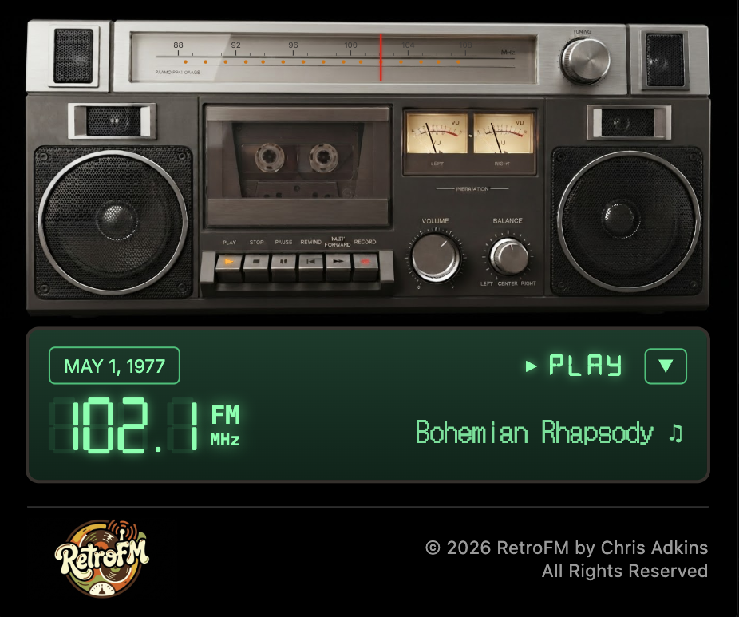

# RetroFM

RetroFM is an AI-powered historical radio simulator and broadcast mixer that recreates authentic, era-accurate radio broadcasts for any chosen historical date. By combining real historical news facts from the New York Times Archive API, music lookup and video playback via YouTube, automatic real-time audio ducking through a companion Chrome extension bridge, and customizable DJ personalities (Mike & Lisa) driven by Google Gemini Flash Text-to-Speech and native browser speech engines, RetroFM delivers an immersive, interactive recreation of listening to top-40 radio in decades past.

---

## Local Docker Development

### Prerequisites
- Docker Desktop with Docker Compose
- Google Chrome (to load the companion Chrome extension bridge)

### First-Time Setup
1. Configure environment variables by copying `.env.example`:
   ```bash
   cp .env.example .env
   ```
   Add your API keys (`GEMINI_API_KEY`, `YOUTUBE_API_KEY`, `NYT_API_KEY`) to `.env`. Note: Never commit real API keys to version control.
2. Build and start the container:
   ```bash
   docker compose up --build
   ```
3. Open the application in Google Chrome:
   - Local Application URL: [http://localhost:3003](http://localhost:3003)
   - Port mapping: Host `3003` -> Container `3000`

### Daily Development Commands
- **Start the application**:
  ```bash
  docker compose up
  ```
- **Stop the application**:
  ```bash
  docker compose down
  ```
- **View application logs**:
  ```bash
  docker compose logs -f retrofm
  ```
- **Check container status**:
  ```bash
  docker compose ps
  ```
- **Rebuild after dependency changes**:
  ```bash
  docker compose up --build
  ```

### Port and Local Access
- **With Docker**: RetroFM runs at [http://localhost:3003](http://localhost:3003) (mapped from container port `3000`).
- **Without Docker (`npm run dev`)**: RetroFM runs on the port printed by `npm run dev` (typically [http://localhost:3000](http://localhost:3000), or another available port). The companion extension and app communication automatically adapt to whatever port is in use.

---

## Getting Started (Local Node/npm)

1. Install dependencies:
   ```bash
   npm install # or bun install
   ```

2. Configure environment variables:
   Copy the example environment file:
   ```bash
   cp .env.example .env
   ```
   Add your API keys to `.env` (see [Environment Variables](#environment-variables)).

3. Run the development server:
   ```bash
   npm run dev
   ```
   Open the application in Google Chrome at the URL printed in the terminal (e.g. `http://localhost:3000`).

4. Build for production:

   ```bash
   npm run build
   npm run start
   ```

---

## Library Setups & Running Modes

RetroFM is designed so that anyone who clones the repository can immediately run it with full DJ features and without requiring an external SQLite database.

### Setup 1: Out-of-the-Box (Sample Dataset)
A fresh clone includes a bundled sample dataset in `public/data/sample/` with ~50 curated songs across multiple dates and decades (1960s to 2000s), complete with authentic Billboard chart rankings, songwriter/producer credits, and active band member histories.

When the full library files are not present, RetroFM detects this and **automatically loads the sample data**:
```bash
# 1. Clone the repository and install dependencies
git clone https://github.com/chris-schmitz/RetroFM.git
cd RetroFM
npm install # or bun install

# 2. Configure .env with your Gemini API key
cp .env.example .env

# 3. Launch the development server
npm run dev # or docker compose up -d
```
Open the URL in Google Chrome ([http://localhost:3003](http://localhost:3003) when running Docker, or the port `npm run dev` prints when running locally). The DJ commentary, era-accurate chart trivia, and song stories will work out of the box using the sample dataset.


---

### Setup 2: Full Historical Library (Building with Database & Builder Scripts)
For power users and contributors wanting the entire 70-year library (~1,800 verified YouTube tracks and 355,800 Billboard Hot 100 weekly chart entries spanning 1958 through today):

1. **SQLite Database Warehouse**:
   The authoritative historical data is maintained in an SQLite database at `~/retrofm/library.sqlite` (containing `songs`, `song_facts`, `band_members`, `artist_aliases`, and `weekly_chart`).
   * The `weekly_chart` data originates from open-source Billboard Hot 100 historical datasets (3,558 consecutive chart weeks from 1958 through today).
   * Music metadata and credits are enriched via MusicBrainz and Wikipedia using the maintenance builder scripts in `scripts/`:
     * `bun run scripts/populate-library-credits.ts`: queries MusicBrainz for songwriter/producer credits.
     * `bun run scripts/populate-band-members.ts`: queries MusicBrainz for band member line-up history with join/leave years.

2. **Deterministic Exporter Command**:
   Whenever you enrich or build `library.sqlite`, run:
   ```bash
   npm run export-library
   ```
   This command:
   * Validates referential integrity (ensuring every credit and fact maps to a valid song ID).
   * Fully regenerates the verified catalog (`public/data/retrofm_library_youtube.json`), extra song references (`public/data/songs_extra.json`), song facts, band members, and artist aliases.
   * Splits the 355,800 weekly chart rankings into decade JSON files (`public/data/chart_facts_<decade>.json`), atomically rewriting **only** decades whose content changed.
   * Clears `.cache/song-cards/` so no stale cache persists.
   * Prints row counts and file sizes. All exported files stay git-ignored.


Configure the following variables in your local `.env` file (do not commit real values to version control):

| Variable | Description | Required / Optional |
| :--- | :--- | :--- |
| `GEMINI_API_KEY` | Google Gemini API key for script generation and Flash Text-to-Speech audio synthesis. | **Required** |
| `YOUTUBE_API_KEY` | YouTube Data API v3 key for searching songs and verifying music duration metadata. | **Required** |
| `NYT_API_KEY` | New York Times API key for querying historical articles from the NYT Archive API. | **Required** |
| `GEMINI_TEXT_MODEL` | Primary Gemini model for DJ break script writing (defaults to `gemini-3.8-flash`). | Optional |
| `GEMINI_TEXT_MODEL_FALLBACK` | Fallback Gemini model invoked if the primary model is busy or times out (e.g. `gemini-2.5-flash`). | Optional |

---

## Companion Chrome Extension Installation & Updating

RetroFM includes a companion Chrome extension that provides bidirectional tab communication, YouTube playback control, smooth audio ducking ramps, and tab grouping.

> **Tip**: Web browsers prevent pages from directly linking to `chrome://` URLs. RetroFM provides a convenient **"Copy chrome://extensions"** button right in the app header and modal.

### First Time Setup
1. Download the extension ZIP (click **Download Extension** in the RetroFM app or download from the repository).
2. Unzip the archive to a folder you will keep (for example, `Documents/retrofm-extension`).
3. In Google Chrome, navigate to `chrome://extensions/`.
4. Turn on the **Developer mode** toggle in the top-right corner.
5. Click **Load unpacked** in the top-left corner and select your `retrofm-extension` folder.
6. Return to RetroFM and click **Launch RetroFM** to automatically open YouTube and group both tabs into an orange "RetroFM" Chrome Tab Group.

### Updating to a New Version
1. Download the new version ZIP package from the RetroFM app.
2. Unzip into the **same folder** (`Documents/retrofm-extension`) and replace existing files.
3. Open `chrome://extensions/`.
4. Click the **Reload arrow ↻** on the RetroFM card (do not remove the card).
5. Refresh your RetroFM and YouTube tabs.

---

## Project Structure

- `src/` &ndash; React application source code, UI components, and state management.
  - `src/services/audio/` &ndash; Central `VolumeController` managing volume ducking, restoring, watchdog monitoring, and ramp IDs.
  - `src/services/music/` &ndash; YouTube music search, playlist timing models, and music provider abstraction.
  - `src/services/news/` &ndash; NYT Archive API provider, national focus filter, category normalizer, and interest scoring.
  - `src/services/djBreak/` &ndash; Two-step DJ break script generation, anachronism audit, and caching.
- `extension/` &ndash; Manifest V3 Chrome extension bridge source files and icons.
- `scripts/` &ndash; Utility scripts (`bump-extension.ts`, `test-music-search.ts`).
- `server.ts` &ndash; Express full-stack proxy server and Vite middleware integration.

---

## License & Third-Party Content Notice

This project is licensed under the **MIT License**. See the [LICENSE](LICENSE) file for the complete text.

**Important Notice**: The MIT License covers only the software code of this application and its companion extension. It does not cover or grant rights to any third-party music recordings, audio streams, YouTube video content, third-party trademarks, logos, or news articles retrieved from upstream APIs. All trademarks, music recordings, and news content belong exclusively to their respective copyright holders.
