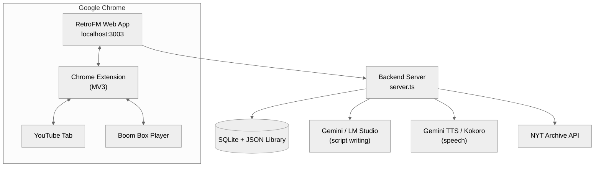
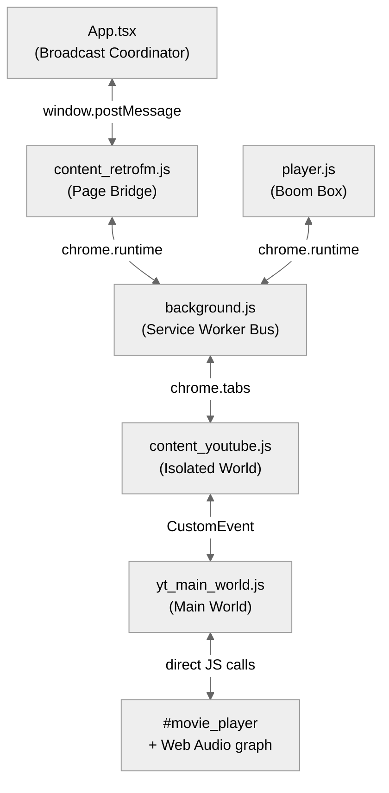
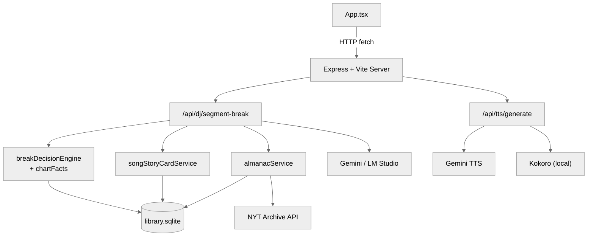
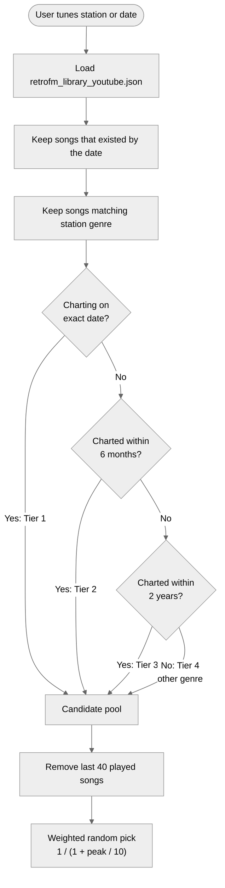
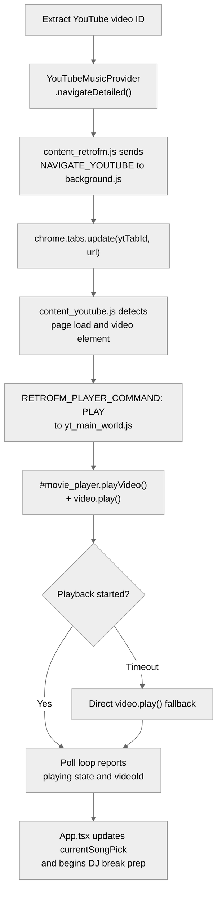
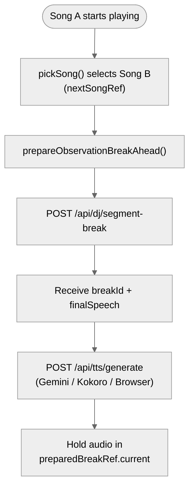
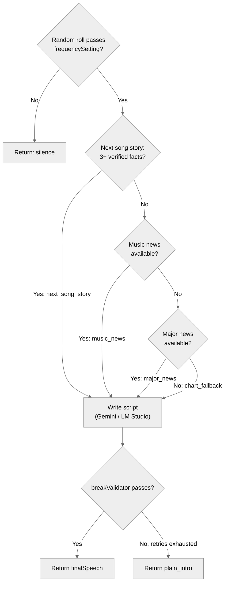
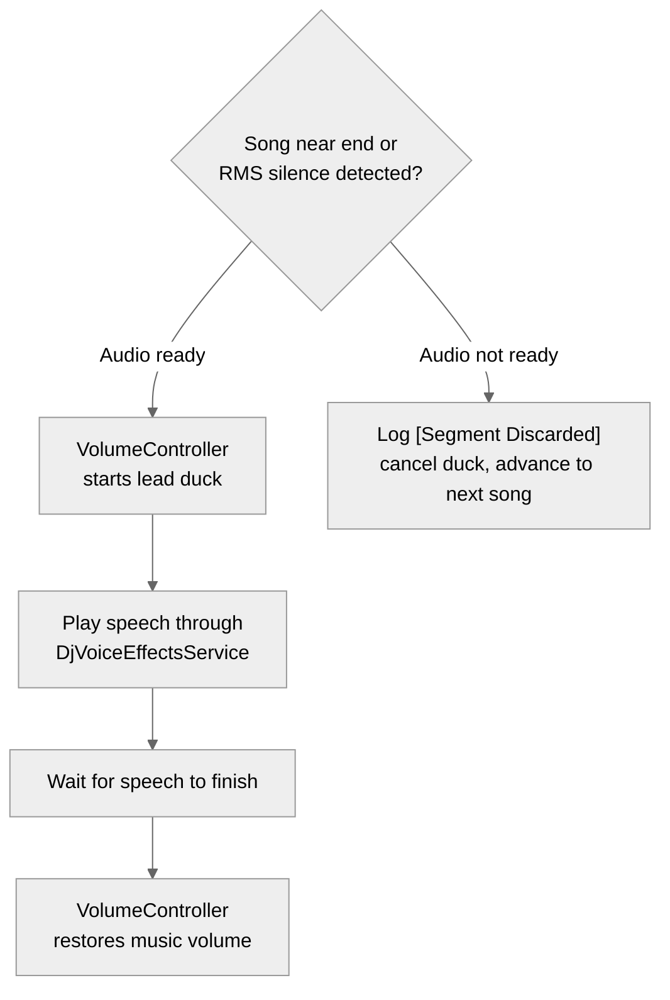
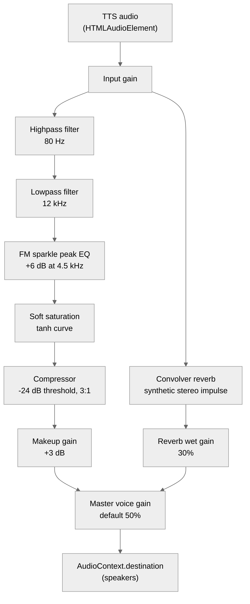
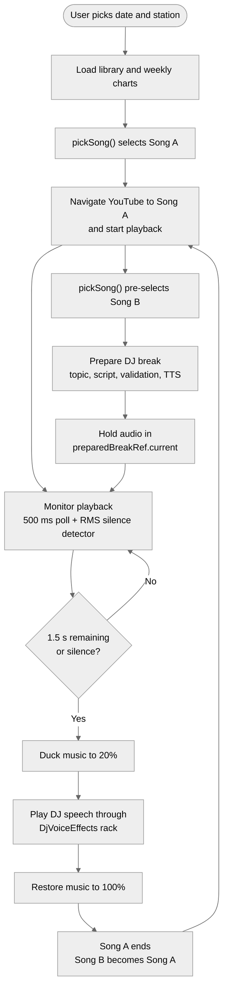

# RetroFM Technical Architecture & Subsystem Specification

**Contents**

1. [Introduction](#1-introduction)
2. [System Architecture](#2-system-architecture)
3. [Music Selection and Playback](#3-music-selection-and-playback)
4. [DJ Commentary and Observations](#4-dj-commentary-and-observations)
5. [Audio Mixing and DJ Ducking](#5-audio-mixing-and-dj-ducking)
6. [Chrome Extension and YouTube Integration](#6-chrome-extension-and-youtube-integration)
7. [Music Library and Data Management](#7-music-library-and-data-management)
8. [End-to-End Broadcast Workflow](#8-end-to-end-broadcast-workflow)
9. [Key Files and Responsibilities](#9-key-files-and-responsibilities)
10. [External Services and Dependencies](#10-external-services-and-dependencies)
11. [Troubleshooting and Known Fallbacks](#11-troubleshooting-and-known-fallbacks)

---

## 1. Introduction

### What RetroFM Is

**RetroFM** is a full-stack, AI-powered historical radio simulator and broadcast mixer. It recreates the experience of listening to commercial Top 40 FM radio for any chosen date from the 1960s through the 2020s.

Rather than streaming pre-recorded podcasts or static playlists, RetroFM simulates a live station operating on that specific day in history. It:

- schedules era-accurate music releases
- tracks contemporaneous Billboard Hot 100 chart performance
- reports verified historical news from The New York Times Archive
- delivers dynamic DJ commentary through personality-driven Large Language Models
- synthesizes natural DJ voices via Text-to-Speech (TTS)
- mixes music and speech with real-time audio ducking across isolated browser execution environments

### Core Simulation Objectives

1. **Historical Authenticity & Temporal Integrity**: Music selection, chart positions, news stories, and song trivia are strictly partitioned by time. If the user tunes to July 4, 1984, the broadcast cannot play songs released after that date, reference future chart peaks, or mention events that had not yet occurred.
2. **Authentic Radio Flow**: The broadcast maintains an unbroken progression of music tracks, station jingles, era-specific station identifications, Billboard chart updates, and natural DJ patter.
3. **Decoupled Architecture with Host Extension Bridge**: Because of browser sandboxing, Cross-Origin Resource Sharing (CORS), and autoplay policies, audio playback (YouTube), broadcast control logic (React/Vite web app), and user controls (the retro Boom Box interface) run in separate browser contexts. A Manifest V3 companion Chrome extension coordinates them.

### Runtime Domains

The system is divided into four runtime domains:

| Domain | Location | Role |
|:--|:--|:--|
| **Client Web Application** | `src/App.tsx` in Chrome at `http://localhost:3003` (Docker) or the port printed by `npm run dev` | Central coordinator. Maintains session state, schedules songs, triggers ahead-of-time DJ pipelines, manages ducking, renders diagnostics. |
| **Companion Chrome Extension** | `extension/` | Manifest V3 extension: background service worker, content script bridges, main-world audio engine, and the Boom Box player. |
| **Backend Server** | `server.ts` | Express and Vite server on port 3000 (host 3003 in Docker). Talks to SQLite or JSON catalogs, news APIs, LLM providers, and TTS engines. |
| **Data & External Services** | Local disk and cloud | SQLite database, JSON catalog, NYT Archive API, YouTube Data API v3, Google Gemini Flash, local Kokoro TTS. |

---

## 2. System Architecture

### Runtime Components & Process Boundaries

RetroFM spans three runtime environments and interacts with four external service domains.

| Component | Runtime | Location | Responsibilities |
|:--|:--|:--|:--|
| **RetroFM UI App** | Browser (React 19) | `localhost:3003` | Session management, UI controls, station tuning, DJ break loops, Web Audio voice effects. |
| **Backend Server** | Docker / Bun / Node.js | Container `3000` (host `3003`) | API routing, Vite HMR proxy, SQLite access, NYT client, LLM prompts, TTS synthesis. |
| **Extension Background** | Chrome MV3 service worker | Background process | Message routing, tab resolution, tab grouping, session persistence. |
| **RetroFM Content Script** | Page bridge | Injected in `localhost:3003` | Bridges `window.postMessage` to `chrome.runtime.sendMessage`. |
| **YouTube Content Script** | Isolated world | Injected in `youtube.com` | Receives playback commands, monitors `<video>`, bridges to the main-world engine. |
| **YouTube Main World** | Main page world | Injected in `youtube.com` | Direct access to `#movie_player`, Web Audio stereo balance, and VU analyzer. |
| **Boom Box Player** | Extension tab | `chrome-extension://.../player/index.html` | Radio tuner, transport keys, frequency dial, volume/balance knobs, LEDs. |
| **SQLite Database** | Local filesystem | `~/retrofm/library.sqlite` | Hot 100 rankings, song facts, band members, credits. |
| **External AI / TTS** | Cloud / local daemon | Gemini API / Kokoro HTTP | Script writing, text validation, speech synthesis. |
| **YouTube Media Host** | Google CDN | `www.youtube.com` | Audio and video streaming. |

### Diagram 1A: System Overview



### Diagram 1B: Browser and Extension Message Path



### Diagram 1C: Backend and Data Services



The client loads `public/data/retrofm_library_youtube.json` directly for song selection (`songSelector.ts`), so routine song picks need no backend call.

---

## 3. Music Selection and Playback

### Song Selection Engine (`src/services/songSelector.ts`)

Song selection is deterministic and consumes no YouTube Search API quota. On startup the app downloads `/data/retrofm_library_youtube.json` (about 2.2 MB), which holds curated tracks that already have verified YouTube video IDs.

#### Song Picking Algorithm (`pickSong`)

`pickSong(library, date, genre, state, rng)` selects tracks using a 4-tier hierarchy:

1. **Tier 1 (Charting Today)**: Songs charting on the Billboard Hot 100 on the exact broadcast date (`s.first_chart_date <= date && runEnd(s) >= date`), matching the station genre (`hasGenre(s, genre)`), and released on or before the broadcast date.
2. **Tier 2 (Charting Within 6 Months)**: Songs matching the genre whose chart run overlapped `[date - 182 days, date]`.
3. **Tier 3 (Charting Within 2 Years)**: Songs matching the genre whose chart run overlapped `[date - 730 days, date]`.
4. **Tier 4 (Contemporary Charting Fallback)**: If nothing in the genre charted within two years, a charting track from another genre is selected to preserve momentum. The UI shows an advisory notice explaining the substitution.

#### Hit Weighting

Songs within each tier are chosen by weighted random distribution:

$$\text{Weight}(s) = \frac{1}{1 + \frac{\text{peak\_position}}{10}}$$

A song that peaked at #1 has a weight of 0.91; a song that peaked at #90 has 0.10. Major hits play more often while top-40 variety is preserved.

#### Anti-Repetition Rules

Session history tracks the last 40 played song IDs in `state.recent`. Unplayed songs in the highest tier are prioritized. If every song in a tier has been played, rotation restarts, but the currently playing song is never repeated back-to-back.

#### Temporal Integrity Checks

`existedBy(song, broadcastDate)` enforces strict chronological boundaries:

- `isStrictlyReleasedBefore(song, broadcastDate)` parses `release_date` by precision:
  - Day (`YYYY-MM-DD`): `rel < broadcastDate`
  - Month (`YYYY-MM`): `rel.slice(0, 7) < broadcastDate.slice(0, 7)`
  - Year (`YYYY`): `rel.slice(0, 4) < broadcastDate.slice(0, 4)`
- Chart emergence: `song.first_chart_date <= broadcastDate`
- Verified streaming link: `song.streaming.youtube.id != null`

---

### Diagram 2A: Song Selection



### Diagram 2B: Starting Playback



---

### Playback Transport Controls and State Synchronization

Transport commands originate in `src/App.tsx` or `extension/player/player.js` (Boom Box) and are executed by `extension/content_youtube.js`:

1. **Play (`PLAY`)**
   - `content_youtube.js` checks `<video>`. If already playing, it acknowledges immediately.
   - Dispatches `RETROFM_PLAYER_COMMAND: 'PLAY'` to `player/yt_main_world.js`, invoking `#movie_player.playVideo()`.
   - Concurrently runs `video.play()` on the HTML5 `<video>` element.
   - Monitors `playing` and `timeupdate` events with a 2000 ms safety timeout.
2. **Pause (`PAUSE`)**
   - Dispatches `RETROFM_PLAYER_COMMAND: 'PAUSE'` (`#movie_player.pauseVideo()`) and calls `video.pause()`.
3. **Stop (`STOP`)**
   - Dispatches `RETROFM_PLAYER_COMMAND: 'STOP'`, runs `video.pause()`, and resets `video.currentTime = 0`.
4. **Seek / Rewind / Fast-Forward (`SEEK`)**
   - Sets `video.currentTime = targetTime` and calls `#movie_player.seekTo(targetTime, true)`.
5. **Volume (`SET_VOLUME` / `RAMP_VOLUME`)**
   - Handled only through `VolumeController.ts` to prevent conflicting audio adjustments.

---

## 4. DJ Commentary and Observations

### Overview & Operational Philosophy

In real radio, DJs speak between songs to establish station identity, share music news, read chart updates, and set up the next track. In RetroFM, commentary is produced by the **Rich Segment Break Pipeline** (`/api/dj/segment-break` in `server.ts`).

### Break Triggers and Ahead-of-Time Preparation

Breaks are not generated when a song ends. LLM generation and neural TTS take several seconds, so RetroFM uses an **Ahead-of-Time Break Pipeline**:

1. **Immediate Pre-Selection**: The moment Song A starts, `src/App.tsx` calls `pickSong()` to choose Song B (`nextSongRef.current`).
2. **Ahead-of-Time Generation**: Once Song B is chosen, `prepareObservationBreakAhead()` asks the backend to pick a topic, write the script, validate the text, and generate TTS audio.
3. **Double Buffering**: Audio is held in memory (`preparedBreakRef.current`). If synthesis finishes early, a second break can be scheduled (`secondPreparedBreakRef.current`).
4. **Song Change Trigger**: As Song A nears its end, one of two mechanisms fires:
   - **Time-Remaining Polling**: Every 500 ms, `App.tsx` checks `remaining = duration - currentTime`. At `remaining <= prep.duckTriggerTimeRemaining` (~1.5 s), lead ducking begins. At `remaining <= prep.triggerTimeRemaining` (~1.0 s), speech starts.
   - **Silence Detection (`END_OF_SONG_TRIGGER`)**: The Web Audio analyzer in `player/yt_main_world.js` computes RMS energy continuously. If energy stays below 0.001 for 1.2 s near the track end, it dispatches `END_OF_SONG_TRIGGER`. `App.tsx` pauses the YouTube track, starts DJ speech immediately, and pre-buffers the next video.

### Diagram 3A: Client-Side Break Preparation



### Candidate Evaluation & Topic Priority

The backend evaluates candidates in a strict priority waterfall:

1. **Next Song Story (`next_song_story`)**
   - Compiles facts about the upcoming song from `~/retrofm/library.sqlite`: this week's chart position (`weekly_chart`), songwriter and producer credits (`song_facts`), band member history (`band_members`), and artist biography (`artist_aliases`).
   - Requires at least **3 verified facts**. With fewer, the pipeline falls through.
2. **Music News (`music_news`)**
   - Queries `almanacService.ts` for music events, album releases, or Billboard announcements from that month in history. Up to 3 candidates are evaluated.
3. **Major News (`major_news`)**
   - Queries `almanacService.ts` and NYT Archive articles for era-accurate national and world news, filtered through `nationalFocusFilter.ts`. Up to 3 candidates are evaluated.
4. **Short Fallback (`chart_fallback`)**
   - A concise 1-2 sentence update on the next song's chart trajectory or songwriter.
5. **Plain Song Intro (`plain_intro`)**
   - If every upstream candidate fails validation or times out: `"Now on RetroFM, here is [Title] by [Artist]."`
6. **Silence**
   - If the break probability roll fails (`roll > frequencySetting`), or the audio is not ready when the song ends, the station stays silent and plays music directly.

### Diagram 3B: Server Topic Selection



### DJ Personalities

Two personalities are defined in `src/services/djBreak/GeminiScriptWriterProvider.ts`:

- **Mike**: Male, late 30s. Veteran Top 40 broadcaster. Punchy, dry humor, fast-paced, authoritative, effortless.
- **Lisa**: Female, early 20s. Energetic, pop-culture oriented, conversational, relatable, quick-witted.

### Text Validation and Anachronism Audit (`src/services/djBreak/breakValidator.ts`)

To prevent LLM hallucination and preserve historical accuracy, scripts must pass deterministic validation:

1. **Length Verification**: Maximum word count is bounded by fact count: $N_{\text{facts}} \times 25 \times 1.35 + 15$. Longer segments are rejected as padding.
2. **Temporal Bounds**: Any 4-digit year later than the broadcast year is rejected. Future retrospection ("this would become a classic in 1999") is blocked.
3. **Grounding Verification**: Every number, year, chart rank, and proper noun must exist in the source fact packet.
4. **Banned Hype Phrases**: Rejects filler such as "one of my personal favorites", "absolute banger", "stay tuned", "coming up next".
5. **Weekday Verification**: Spoken days of the week are checked against the Gregorian date of the broadcast.

### Diagram 3C: Break Trigger and Playback



---

## 5. Audio Mixing and DJ Ducking

### Audio Ducking Authority (`src/services/audio/VolumeController.ts`)

`VolumeController` is the single authority over music volume. Conflicting commands from user interaction, animation, and speech are eliminated by strict state-machine rules.

```
idle --duck--> ducking --> ducked --restore--> restoring --> idle

cancel: returns to idle from any state
```

#### Core Operational Rules

1. **State Isolation**: States are `idle`, `ducking`, `ducked`, or `restoring`. A request to start a new duck while a sequence is running is discarded.
2. **Authoritative Baseline**: `userVolume` (default 100%) is captured only in the `idle` state. Mid-ramp values are never treated as baseline, so music always restores to the user's master setting.
3. **Single Ramp Protocol**: Instead of streaming hundreds of volume messages over IPC, the controller sends one `RAMP_VOLUME` command with target volume, duration, and a unique `rampId`.
4. **Stale Ramp Cancellation**: Every ramp carries an incrementing `rampId`. If the user moves the master slider or skips a song mid-duck, stale timers and ramps are discarded.
5. **Watchdog Verification**: For 10 seconds after a restoration ramp, a watchdog logs any external volume change not made by the controller.
6. **Safety Timeout**: A 45-second watchdog restores music volume if speech playback hangs or fails.

---

### DJ Voice Processing Chain (`src/services/audio/DjVoiceEffectsService.ts`)

DJ speech is processed in real time with the Web Audio API. Audio is routed through an effects rack that simulates commercial FM broadcast processing.

### Diagram 4A: Voice Processing Rack



### Ducking Sequence (Diagram 4B)

Normal playback runs at `userVolume` (for example 100%). The numbered steps below show one complete duck-and-restore cycle.

| # | Actor | Action |
|:--|:--|:--|
| 1 | `App.tsx` | Song has 1.5 s or less remaining (or silence detected). Calls `duck(fadeDownMs = 800, reason = "DJ speech start")`. |
| 2 | `VolumeController` | Sets `state = 'ducking'`, `activeRampId = 42`. Sends `RAMP_VOLUME(target = 0.20, duration = 800 ms, rampId = 42)` to `content_youtube.js`. |
| 3 | `content_youtube.js` | Runs `smoothRampVolume` (sinusoidal ease-in-out steps) against `#movie_player` via `yt_main_world.js`. |
| 4 | `yt_main_world.js` | Reports volume reached 20%. |
| 5 | `VolumeController` | Sets `state = 'ducked'`. Music holds at the 20% duck level. |
| 6 | `App.tsx` | Calls `DjVoiceEffectsService.playDJSpeech(audioData, voiceVolume = 0.50)`. |
| 7 | Speech engine | Plays voice through the Web Audio graph. `onended` fires when done. |
| 8 | `App.tsx` | Calls `restore(fadeUpMs = 1200, reason = "DJ speech finished")`. |
| 9 | `VolumeController` | Sets `state = 'restoring'`, `activeRampId = 43`. Sends `RAMP_VOLUME(target = 1.00, duration = 1200 ms, rampId = 43)`. |
| 10 | `content_youtube.js` / `yt_main_world.js` | Run the same smooth ramp. Report volume reached 100%. |
| 11 | `VolumeController` | Sets `state = 'idle'` and starts the 10 s watchdog. Normal playback is restored. |

---

## 6. Chrome Extension and YouTube Integration

### Extension Architecture

The companion extension bridges the security boundaries between the RetroFM web app (`localhost:3003`), the YouTube video tab (`youtube.com`), and the standalone Boom Box player (`chrome-extension://...`).

### Component Responsibilities & Message Routing

| Channel | Path | Mechanism | Message Types |
|:--|:--|:--|:--|
| **App Bridge** | `App.tsx` → `content_retrofm.js` | `window.postMessage` (`RETRO_FM_PAGE`) | `PING`, `NAVIGATE_YOUTUBE`, `COMMAND_YOUTUBE`, `RAMP_VOLUME` |
| **Page Relay** | `content_retrofm.js` → `background.js` | `chrome.runtime.sendMessage` | JSON RPC with incrementing message IDs |
| **Tab Command** | `background.js` → `content_youtube.js` | `chrome.tabs.sendMessage` | `PLAY`, `PAUSE`, `STOP`, `SEEK`, `SET_VOLUME`, `RAMP_VOLUME` |
| **World Bridge** | `content_youtube.js` → `yt_main_world.js` | `window.dispatchEvent` (CustomEvent) | `RETROFM_SET_YT_VOLUME`, `RETROFM_PLAYER_COMMAND`, `RETROFM_SET_YT_BALANCE` |
| **Status Push** | `yt_main_world.js` → `content_youtube.js` | CustomEvents and `postMessage` | `RETROFM_YT_STATE_CHANGED`, `RETROFM_VU_LEVELS_MSG` |
| **State Relay** | `content_youtube.js` → `background.js` | `chrome.runtime.sendMessage` | `YT_STATE_CHANGED`, `VU_AUDIO_LEVELS`, `RECORD_TRACE` |
| **Boom Box Bus** | `player.js` → `background.js` | `chrome.runtime.sendMessage` | `BOOMBOX_ACTION` (tuning, preset, transport, volume) |
| **State Push** | `background.js` → `player.js` | `chrome.tabs.sendMessage` | `APPLY_RADIO_STATE` (song, artist, year, frequency, dial) |

### Communication and Event Flow (Diagram 5)

Example: the user presses Play on the Boom Box.

**Phase 1: Boom Box to web app**

| # | From → To | Mechanism | Message |
|:--|:--|:--|:--|
| 1 | `player.js` → `background.js` | `chrome.runtime.sendMessage` | `BOOMBOX_ACTION { action: 'PLAY' }` |
| 2 | `background.js` → `content_retrofm.js` | `chrome.tabs.sendMessage` | `BOOMBOX_ACTION` |
| 3 | `content_retrofm.js` → `App.tsx` | `window.postMessage` | `BOOMBOX_ACTION` |

**Phase 2: Web app to YouTube**

| # | From → To | Mechanism | Message |
|:--|:--|:--|:--|
| 4 | `App.tsx` → `content_retrofm.js` | `window.postMessage` | `COMMAND_YOUTUBE { command: 'PLAY' }` |
| 5 | `content_retrofm.js` → `background.js` | `chrome.runtime.sendMessage` | `COMMAND_YOUTUBE` |
| 6 | `background.js` → `content_youtube.js` | `chrome.tabs.sendMessage` | `PLAY` |
| 7 | `content_youtube.js` → `yt_main_world.js` | CustomEvent | `RETROFM_PLAYER_COMMAND 'PLAY'` |
| 8 | `yt_main_world.js` → `<video>` | Direct call | `#movie_player.playVideo()` and `video.play()` |

**Phase 3: State reported back to the Boom Box**

| # | From → To | Mechanism | Message |
|:--|:--|:--|:--|
| 9 | `<video>` → `yt_main_world.js` | Native events | `playing`, `timeupdate` |
| 10 | `yt_main_world.js` → `content_youtube.js` | CustomEvent | `RETROFM_YT_STATE_CHANGED { state: 1, currentTime }` |
| 11 | `content_youtube.js` → `background.js` | `chrome.runtime.sendMessage` | `YT_STATE_CHANGED` |
| 12 | `background.js` → `content_retrofm.js` | `chrome.tabs.sendMessage` | `YT_STATE_CHANGED` |
| 13 | `content_retrofm.js` → `App.tsx` | `window.postMessage` | `YT_STATE_CHANGED` |
| 14 | `App.tsx` → `background.js` | `chrome.runtime.sendMessage` | `BROADCAST_RADIO_STATE` |
| 15 | `background.js` → `player.js` | `chrome.tabs.sendMessage` | `APPLY_RADIO_STATE` |

The Boom Box then lights the Play LED and updates its metadata display.

---

## 7. Music Library and Data Management

### Authoritative SQLite Database (`~/retrofm/library.sqlite`)

The primary data store lives at `~/retrofm/library.sqlite`. It is queried at runtime through Node.js `DatabaseSync` (`node:sqlite`) or `bun:sqlite`.

#### Core Database Schema

| Table | Purpose | Columns |
|:--|:--|:--|
| **`songs`** | Master catalog of historical tracks | `id`, `title`, `artist`, `primary_artist`, `chart_year`, `chart_year_rank`, `decade`, `release_date`, `release_date_precision`, `album`, `duration_sec`, `mbid`, `genres`, `primary_genre`, `peak_position`, `first_chart_date`, `last_chart_date`, `peak_date`, `weeks_on_chart`, `streaming` (JSON with YouTube ID) |
| **`weekly_chart`** | Weekly Billboard Hot 100 history | `chart_date` (YYYY-MM-DD), `rank` (1-100), `title`, `performer`. Indexed on `idx_wc_date` and `idx_wc_title`. |
| **`song_facts`** | Verified trivia and credits | `song_id`, `fact_type` (`writer` or `producer`), `fact_text`, `event_date`, `public_date`, `source`, `source_url`, `times_used` |
| **`band_members`** | Era-accurate band rosters | `band_name`, `member_name`, `begin_date`, `end_date` |
| **`artist_aliases`** | Alternative artist names | `artist_name`, `alias_name`, `alias_type` |
| **`genres`** | Decade-by-decade musical taxonomy | (permissible genres per decade) |
| **`bad_videos`** | Blacklist of broken, restricted, or low-quality YouTube IDs | (video IDs) |

### Static JSON Distribution (`/public/data/retrofm_library_youtube.json`)

To avoid runtime database locks and keep the client independent, a sanitized snapshot of the `songs` table is exported to `/public/data/retrofm_library_youtube.json`. The web client loads it into memory on startup, so routine song selection needs no SQL queries or backend calls.

---

## 8. End-to-End Broadcast Workflow

### Complete Cycle Overview

A broadcast is a continuous loop of station tuning, track playback, ahead-of-time DJ preparation, real-time ducking, and auto-advancement.

### Diagram 6: Broadcast Loop



The stages in the loop:

1. **Station Configuration**: User selects a date (for example 1985-07-13) and station (for example CHR); the app loads the in-memory library and weekly chart data.
2. **Song Selection & Playback**: `pickSong()` selects Song A, the YouTube tab navigates to it, and volume syncs to the master setting.
3. **Ahead-of-Time DJ Break Pipeline**: Song B is pre-selected; the server evaluates Song Story, then Music News, then Major News; Gemini or LM Studio writes a 1-2 sentence script; `breakValidator` checks grounding, years, and weekdays; Gemini TTS or Kokoro synthesizes speech.
4. **Playback Monitoring & Mixing**: A 500 ms poller and the Web Audio RMS monitor watch for the trigger; then duck, speak, restore.
5. **Track Transition**: Song A finishes, the app advances to Song B, and the cycle repeats.

---

## 9. Key Files and Responsibilities

All paths are repository-relative.

### Backend and App

| File | Responsibility |
|:--|:--|
| `server.ts`<br/>`startServer`, Express routes | Hosts API endpoints, serves the Vite SPA, interfaces with SQLite, LLMs, and TTS. |
| `src/App.tsx`<br/>`App`, `playLibrarySongInternal`, `handlePlayDjSpeech` | Central state coordinator, playback loop, DJ timing triggers, diagnostics. |

### Music

| File | Responsibility |
|:--|:--|
| `src/services/songSelector.ts`<br/>`pickSong`, `existedBy`, `isStrictlyReleasedBefore` | Deterministic selection, 4-tier filtering, release date validation, hit weighting. |
| `src/services/music/YouTubeMusicProvider.ts`<br/>`YouTubeMusicProvider` | Client bridge to the extension via `window.postMessage`. |
| `src/services/music/songSearch.ts`<br/>`searchYouTubeForSong`, `getVideoDuration` | Fallback YouTube Search API client and duration cache. |
| `src/services/music/songStoryCardService.ts`<br/>`getOrBuildSongStoryCard` | Compiles song facts, band members, and Wikipedia story cards for upcoming tracks. |

### News

| File | Responsibility |
|:--|:--|
| `src/services/news/factPacketService.ts`<br/>`buildFactPacket`, `getNewsSessionStats` | Retrieves, filters, and packages historical articles from the NYT Archive API. |
| `src/services/news/almanacService.ts`<br/>`getOrBuildAlmanac`, `resolveRelativeTimeWords` | Builds daily almanacs, resolves relative time words, assigns news categories. |

### DJ Breaks

| File | Responsibility |
|:--|:--|
| `src/services/djBreak/breakDecisionEngine.ts`<br/>`decideAndSelectBreak`, `SongCreditRepository` | Evaluates eligible candidates, checks session history, avoids repeating fact types. |
| `src/services/djBreak/chartFacts.ts`<br/>`ChartFactRepository`, `computeChartFacts` | Queries `weekly_chart` for ranking trajectory and #1 hits. |
| `src/services/djBreak/breakValidator.ts`<br/>`validateSegmentBreakOutput`, `validateBreakOutput` | Verifies script length, grounding, historical years, and banned words. |
| `src/services/djBreak/GeminiScriptWriterProvider.ts`<br/>`GeminiScriptWriterProvider` | Generates DJ scripts and audits with Google Gemini models. |
| `src/services/djBreak/LMStudioScriptWriterProvider.ts`<br/>`LMStudioScriptWriterProvider` | Local LLM fallback via OpenAI-compatible LM Studio endpoints. |

### Text-to-Speech

| File | Responsibility |
|:--|:--|
| `src/services/tts/GeminiTTSProvider.ts`<br/>`GeminiTTSProvider` | Neural speech with Gemini Flash audio preview models. |
| `src/services/tts/KokoroTTSProvider.ts`<br/>`KokoroTTSProvider` | Local neural TTS via the Kokoro-82M container or daemon. |
| `src/services/ttsClient.ts`<br/>`generateTTS`, `fetchKokoroStatus` | Client HTTP wrapper for `/api/tts/generate`. |

### Audio

| File | Responsibility |
|:--|:--|
| `src/services/audio/VolumeController.ts`<br/>`VolumeController` | Single authority for ducking, restoring, watchdogs, and ramp IDs. |
| `src/services/audio/DjVoiceEffectsService.ts`<br/>`DjVoiceEffectsService` | Real-time Web Audio rack: FM compression, EQ, saturation, reverb. |

### Chrome Extension

| File | Responsibility |
|:--|:--|
| `extension/background.js`<br/>`handleIncomingRequest`, `resolveRetroFmTab` | MV3 service worker routing IPC between extension tabs and content scripts. |
| `extension/content_retrofm.js`<br/>`onWindowMessage`, `announceReady` | Bridges web app `window.postMessage` events to `chrome.runtime.sendMessage`. |
| `extension/content_youtube.js`<br/>`smoothRampVolume`, `getPlaybackStatus` | Controls the YouTube `<video>` DOM, listens for commands, dispatches main-world events. |
| `extension/player/yt_main_world.js`<br/>`ensureStereoBalanceNodes`, `applyVolumeToPlayer` | Injected into the YouTube main world; controls `#movie_player`, balance, and VU meter. |
| `extension/player/player.js`<br/>`act`, `applyRadioState`, `setVisualTransport` | Boom Box radio interface: presets, frequency dial, volume knob. |

---

## 10. External Services and Dependencies

### AI Text Generation

- **Google Gemini API**
  - Primary model: `gemini-3.8-flash` (configurable via `GEMINI_TEXT_MODEL`).
  - Fallback model: `gemini-2.5-flash` (configurable via `GEMINI_TEXT_MODEL_FALLBACK`).
  - Role: DJ break script writing and historical anachronism audits.
- **LM Studio (Local LLM)**
  - Connects to a local OpenAI-compatible endpoint (default `http://localhost:1234/v1`).
  - Role: fast, offline script-writing alternative.

### Text-to-Speech (TTS)

- **Google Gemini Flash TTS**
  - Primary model: `gemini-2.5-flash-preview-tts` (fallback: `gemini-3.8-flash-lite-tts`).
  - Voices: `Puck` (energetic male radio host), `Aoede` (expressive female radio host).
- **Kokoro-82M TTS**
  - Connects to a local Kokoro HTTP daemon (default `http://127.0.0.1:8880`).
  - Voices: `am_michael` (American male DJ), `bm_george` (British BBC host), `af_bella` (American female).
- **Instant Browser Speech**
  - Native Web Speech API (`window.speechSynthesis`). Zero network latency; runs locally in Chrome.

### Upstream APIs

- **New York Times Archive API**: Historical news retrieval by publication year and month.
- **YouTube Data API v3**: Track search and video duration verification.

---

## 11. Troubleshooting and Known Fallbacks

### Critical Service Fallbacks

| Failure Event | Detection | Fallback Behavior |
|:--|:--|:--|
| **Gemini API 429 quota exceeded** | HTTP 429 / `RESOURCE_EXHAUSTED` | Switches TTS engine to `BROWSER` (Web Speech API) with no downtime. |
| **LLM script writing timeout** | 25 s candidate queue budget | Aborts generation; delivers a clean `plain_intro` or silence. |
| **TTS synthesis failure** | Server HTTP 500 / empty buffer | Break is discarded; station stays silent and plays music without stalling. |
| **Break audio not ready at song end** | `prep.audioData == null` at trigger | Logs `[DJ skipped: audio not ready]`, cancels lead duck, plays next track. |
| **YouTube autoplay blocked** | `video.play()` rejection | Extension alerts the user; app offers a one-time click prompt to satisfy Chrome's user-gesture policy. |
| **Background tab throttling** | `document.visibilityState == 'hidden'` | `DjVoiceEffectsService` runs a silent keep-alive loop so Chrome does not suspend the AudioContext. |
| **Extension context invalidation** | `chrome.runtime.lastError` | Page bridge re-injects on extension update; prompts the user to reload tabs. |
| **Ducking lockup / hang** | 45 s watchdog in `VolumeController` | Cancels the active duck and restores music to `userVolume`. |
