# RetroFM Technical Architecture & Subsystem Specification

## 1. Introduction

### What RetroFM Is
**RetroFM** is a full-stack, AI-powered historical radio simulator and broadcast mixer. The application accurately recreates the authentic experience of listening to commercial Top 40 FM radio broadcasts for any chosen historical date from the 1960s through the 2020s.

Rather than streaming pre-recorded podcasts or static playlists, RetroFM simulates a live radio station operating in real time on that specific day in history. It schedules era-accurate music releases, tracks contemporaneous Billboard Hot 100 chart performance, reports verified historical news from The New York Times Archive, delivers dynamic DJ commentary through personality-driven Large Language Models, synthesizes natural DJ voices via Text-to-Speech (TTS), and mixes music and speech using real-time audio ducking across isolated browser execution environments.

### Core Simulation Objectives
1. **Historical Authenticity & Temporal Integrity**: Music selection, chart positions, news stories, and song trivia are strictly partitioned by time. If the user tunes to July 4, 1984, the broadcast cannot play songs released after that date, reference future chart peaks, or mention historical events that had not yet occurred.
2. **Authentic Radio Flow**: The broadcast maintains an unbroken progression of music tracks, station jingles, era-specific station identifications, Billboard chart updates, and natural DJ patter.
3. **Decoupled Architecture with Host Extension Bridge**: Due to strict browser sandboxing, Cross-Origin Resource Sharing (CORS), and autoplay policies, audio playback (YouTube), broadcast control logic (React/Vite web application), and hardware-like user controls (the retro Boom Box interface) run across separate browser contexts coordinated through a Manifest V3 companion Chrome extension.

### High-Level Component Interaction
The system is divided into four distinct runtime domains:
- **Client Web Application (`src/App.tsx`)**: The central coordinator running in Google Chrome on `http://localhost:3003` (with Docker) or on the local port printed by `npm run dev` (without Docker). It maintains session state, schedules songs, triggers ahead-of-time DJ commentary pipelines, manages audio ducking sequences, and renders diagnostic controls.
- **Companion Chrome Extension (`extension/`)**: A Manifest V3 extension with a background service worker (`background.js`), content script bridges (`content_retrofm.js`, `content_youtube.js`), an isolated main-world audio engine (`player/yt_main_world.js`), and a standalone skeuomorphic player interface (`player/player.js` / Boom Box).
- **Node.js/Bun Backend Server (`server.ts`)**: An Express and Vite development server listening on port 3000 (mapped to host 3003 in Docker, or running directly on port 3000/PORT locally). It interfaces with local SQLite databases or static JSON catalogs, external news APIs, Gemini and LM Studio LLM providers, and TTS engines.
- **Data Repositories & External Services**: A local SQLite database (`~/retrofm/library.sqlite`), pre-compiled JSON catalog files (`/public/data/retrofm_library_youtube.json`), the New York Times Archive API, YouTube Data API v3, Google Gemini Flash models, and local Kokoro TTS servers.

---

## 2. System Architecture

### Runtime Domains & Process Boundaries

RetroFM spans three runtime environments and interacts with four external service domains:

| Component | Runtime Environment | Host / Port / Boundary | Primary Responsibilities |
| :--- | :--- | :--- | :--- |
| **RetroFM UI App** | Browser (DOM / React 19) | `http://localhost:3003` | Session management, UI controls, station tuning, DJ break trigger loops, Web Audio voice effects. |
| **Backend Server** | Docker / Bun / Node.js | Container `3000` (Host `3003`) | API routing, Vite HMR proxy, SQLite access, NYT API client, LLM prompts, TTS synthesis. |
| **Extension Background**| Chrome MV3 Service Worker | Background process | Message bus routing, tab resolution, tab grouping, session persistence. |
| **RetroFM Content Script**| Browser (Page Bridge) | Injected in `localhost:3003` | Bridges `window.postMessage` to `chrome.runtime.sendMessage`. |
| **YouTube Content Script**| Browser (Isolated World) | Injected in `youtube.com` | Receives playback commands, monitors `<video>` DOM, bridges to main-world audio engine. |
| **YouTube Main World** | Browser (Main Page World) | Injected in `youtube.com` | Direct access to YouTube HTML5 player API (`#movie_player`), Web Audio stereo balance and VU analyzer. |
| **Boom Box Player** | Chrome Extension Tab | `chrome-extension://.../player/index.html` | Skeuomorphic radio tuner, transport keys, frequency dial, volume/balance knobs, LED indicators. |
| **SQLite Database** | Host Local Filesystem | `~/retrofm/library.sqlite` | Authoritative storage for 70+ years of Hot 100 chart rankings, song facts, band members, and credits. |
| **External AI / TTS** | Google Cloud / Local daemon | Google Gemini API / Kokoro HTTP | Script writing, text validation, neural speech synthesis. |
| **YouTube Media Host** | Google YouTube CDN | `www.youtube.com` | Media audio and video streaming. |

---

### Architectural Communication Diagram (Diagram 1)

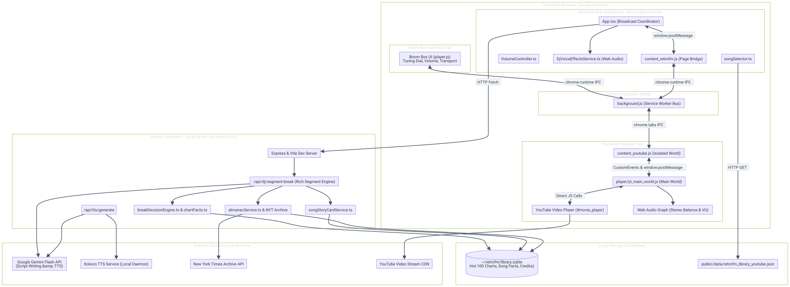

<details>
<summary>View Mermaid Source</summary>

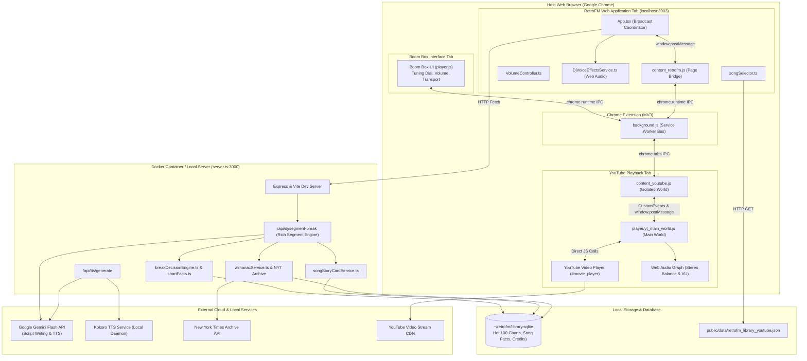

</details>

---

## 3. Music Selection and Playback

### Song Selection Engine (`src/services/songSelector.ts`)
Song selection is entirely deterministic and runs without consuming YouTube Search API quota. When the application starts, it downloads `/data/retrofm_library_youtube.json` (approximately 2.2 MB), which contains curated tracks that already possess verified YouTube video IDs.

#### Song Picking Algorithm (`pickSong`)
The function `pickSong(library, date, genre, state, rng)` selects tracks using a 4-tier hierarchy:
1. **Tier 1 (Charting Today)**: Songs actively charting on the Billboard Hot 100 on the exact broadcast date (`s.first_chart_date <= date && runEnd(s) >= date`), matching the requested station genre (`hasGenre(s, genre)`), and strictly released on or before the broadcast date.
2. **Tier 2 (Charting Within 6 Months)**: Songs matching the genre whose chart run overlapped the window `[date - 182 days, date]`.
3. **Tier 3 (Charting Within 2 Years)**: Songs matching the genre whose chart run overlapped the window `[date - 730 days, date]`.
4. **Tier 4 (Contemporary Charting Fallback)**: If no songs in the requested genre were charting within two years, a charting track from another genre active on that date is selected to preserve broadcast momentum. The UI displays an advisory notice explaining the substitution.

#### Hit Weighting
Songs within each tier are selected using weighted random distribution:
$$\text{Weight}(s) = \frac{1}{1 + \frac{\text{peak\_position}}{10}}$$
A song that peaked at #1 receives a weight of $0.91$, whereas a song peaking at #90 receives $0.10$. This ensures major hits play more frequently while retaining realistic top-40 variety.

#### Anti-Repetition Rules
Session history tracks the last 40 played song IDs in `state.recent`. Fresh, unplayed songs in the highest tier are prioritized. If all available songs in a tier have been played, rotation begins again, but the system strictly forbids repeating the currently playing song back-to-back.

#### Temporal Integrity Checks
The helper `existedBy(song, broadcastDate)` enforces strict chronological boundaries:
- `isStrictlyReleasedBefore(song, broadcastDate)`: Parses `release_date` with precision rules:
  - Day precision (`YYYY-MM-DD`): `rel < broadcastDate`
  - Month precision (`YYYY-MM`): `rel.slice(0, 7) < broadcastDate.slice(0, 7)`
  - Year precision (`YYYY`): `rel.slice(0, 4) < broadcastDate.slice(0, 4)`
- Chart emergence: `song.first_chart_date <= broadcastDate`
- Verified streaming link: `song.streaming.youtube.id != null`

---

### Music Playback Lifecycle Flowchart (Diagram 2)

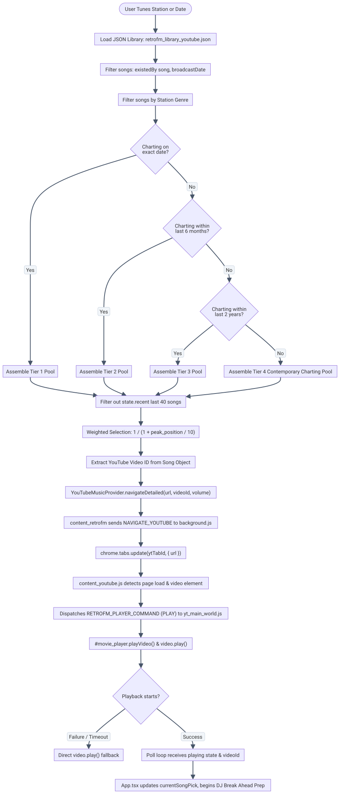

<details>
<summary>View Mermaid Source</summary>

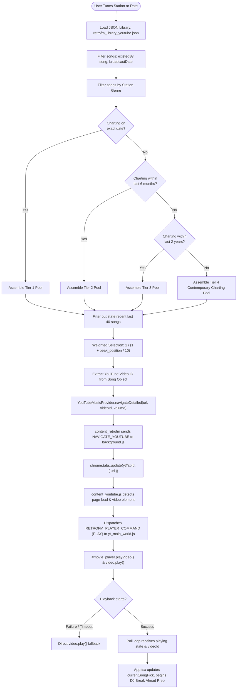

</details>

---

### Playback Transport Controls and State Synchronization

Transport commands originate in either `src/App.tsx` or `extension/player/player.js` (Boom Box) and are executed by `extension/content_youtube.js`:

1. **Play (`PLAY`)**:
   - `content_youtube.js` checks `<video>`. If already playing, it acknowledges immediately.
   - Dispatches `RETROFM_PLAYER_COMMAND: 'PLAY'` to `player/yt_main_world.js`, invoking YouTube's native `#movie_player.playVideo()`.
   - Concurrently executes `video.play()` on the native HTML5 `<video>` element.
   - Monitors `playing` and `timeupdate` events with a 2000ms safety timeout.
2. **Pause (`PAUSE`)**:
   - Dispatches `RETROFM_PLAYER_COMMAND: 'PAUSE'` (`#movie_player.pauseVideo()`) and calls `video.pause()`.
3. **Stop (`STOP`)**:
   - Dispatches `RETROFM_PLAYER_COMMAND: 'STOP'`, executes `video.pause()`, and resets position: `video.currentTime = 0`.
4. **Seek / Rewind / Fast-Forward (`SEEK`)**:
   - Commands set `video.currentTime = targetTime` and notify `#movie_player.seekTo(targetTime, true)`.
5. **Volume (`SET_VOLUME` / `RAMP_VOLUME`)**:
   - Handled exclusively through `VolumeController.ts` to prevent conflicting audio adjustments.

---

## 4. DJ Commentary and Observations

### Overview & Operational Philosophy
In authentic radio broadcasting, DJs speak between songs to establish station identity, share music news, read Billboard chart updates, and give context to the next track. In RetroFM, DJ commentary is managed by the **Rich Segment Break Pipeline** (`/api/dj/segment-break` in `server.ts`).

### Break Triggers and Ahead-of-Time Preparation
DJ breaks are not generated at the moment a song ends. Because LLM generation and neural TTS synthesis take several seconds, RetroFM uses an **Ahead-of-Time Break Pipeline**:
1. **Immediate Pre-Selection**: The exact moment Song A begins playing, `src/App.tsx` immediately invokes `pickSong()` to choose Song B (`nextSongRef.current`).
2. **Ahead-of-Time Generation**: As soon as Song B is selected, `prepareObservationBreakAhead()` calls the backend server to decide the break topic, write the script, validate the text, and generate TTS audio.
3. **Double Buffering**: Audio is held in memory (`preparedBreakRef.current`). If synthesis completes early, a second break ahead can be scheduled (`secondPreparedBreakRef.current`).
4. **Song Change Trigger**: As Song A nears completion, the break triggers via two mechanisms:
   - **Time-Remaining Polling**: Every 500ms, `App.tsx` checks `remaining = duration - currentTime`. When `remaining <= prep.duckTriggerTimeRemaining` (~1.5s), lead ducking begins. At `remaining <= prep.triggerTimeRemaining` (~1.0s), speech playback begins.
   - **Silence Detection (`END_OF_SONG_TRIGGER`)**: The Web Audio analyzer in `player/yt_main_world.js` continuously computes RMS audio energy. If audio energy drops below $0.001$ for 1.2 seconds near the track end, it dispatches `END_OF_SONG_TRIGGER`. `App.tsx` pauses the YouTube track, starts DJ speech immediately, and pre-buffers the next video in the background.

---

### Candidate Evaluation & Topic Priority
The backend server evaluates candidates in a strict priority waterfall:
1. **Next Song Story (`next_song_story`)**:
   - Compiles facts about the upcoming song from `~/retrofm/library.sqlite`, including its exact Billboard chart position this week (`weekly_chart`), song credits (songwriter and producer from `song_facts`), band member history (`band_members`), and artist biography (`artist_aliases`).
   - Requires a minimum of **3 verified facts**. If fewer than 3 facts exist, the pipeline falls through to the next candidate.
2. **Music News (`music_news`)**:
   - Queries `almanacService.ts` for historical music events, album releases, or Billboard announcements from that month in history. Up to 3 candidate items are evaluated.
3. **Major News (`major_news`)**:
   - Queries `almanacService.ts` and New York Times Archive articles for era-accurate national and world news, filtered through `nationalFocusFilter.ts`. Up to 3 candidate items are evaluated.
4. **Short Fallback (`chart_fallback`)**:
   - Delivers a concise 1–2 sentence update on the next song's chart trajectory or songwriter.
5. **Plain Song Intro (`plain_intro`)**:
   - If all upstream candidates fail validation or time out, the system delivers a clean intro: `"Now on RetroFM, here is [Title] by [Artist]."`
6. **Silence**:
   - If the break probability roll fails (`roll > frequencySetting`), or if the break audio is not ready when the song ends, the station remains silent and plays music directly.

---

### DJ Personalities
RetroFM provides two distinct radio personalities defined in `src/services/djBreak/GeminiScriptWriterProvider.ts`:
- **Mike**: Male, late 30s. Veteran Top 40 radio broadcaster. Punchy, dry humor, fast-paced, authoritative, and effortless broadcast tone.
- **Lisa**: Female, early 20s. Energetic, pop-culture oriented, conversational, relatable, and quick-witted Top 40 personality.

---

### Text Validation and Anachronism Audit (`src/services/djBreak/breakValidator.ts`)
To prevent LLM hallucination and maintain strict historical accuracy, generated scripts must pass rigorous deterministic validation:
1. **Length Verification**: Maximum allowable word count is strictly bounded by fact count ($N_{\text{facts}} \times 25 \times 1.35 + 15$). Segments exceeding this are rejected for padding.
2. **Temporal Bounds**: Any 4-digit year greater than the broadcast year is instantly rejected. Future retrospection (e.g., "this would become a classic in 1999") is blocked.
3. **Grounding Verification**: Every number, year, chart rank, and proper noun in the generated script must exist in the source fact packet.
4. **Banned Hype Phrases**: Rejects artificial filler ("one of my personal favorites", "absolute banger", "stay tuned", "coming up next").
5. **Weekday Verification**: Spoken days of the week are verified against the Gregorian calendar date of the historical broadcast.

---

### DJ Observation Lifecycle Flowchart (Diagram 3)

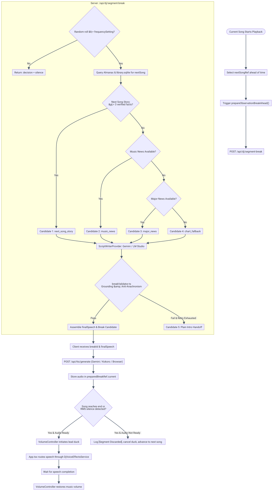

<details>
<summary>View Mermaid Source</summary>

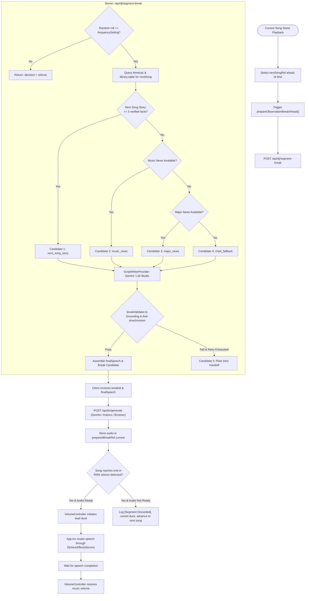

</details>

---

## 5. Audio Mixing and DJ Ducking

### Audio Ducking Authority (`src/services/audio/VolumeController.ts`)
`VolumeController` is the single authority governing music volume in RetroFM. Conflicting volume commands from user interactions, animations, and speech sequences are eliminated by strict state-machine rules:

```
[idle] ---> (duck) ---> [ducking] ---> [ducked] ---> (restore) ---> [restoring] ---> [idle]
   ^                                                                                     |
   +------------------------------ (cancel) ---------------------------------------------+
```

#### Core Operational Rules
1. **State Isolation**: States are strictly `idle`, `ducking`, `ducked`, or `restoring`. Requests to initiate a new duck while a sequence is running are discarded.
2. **Authoritative Baseline**: `userVolume` (default 100%) is captured *only* while in the `idle` state. The controller never treats mid-ramp values as normal baseline, ensuring music always restores to the user's master volume setting.
3. **Single Ramp Protocol**: Instead of streaming hundreds of volume messages over IPC, `VolumeController` sends a single `RAMP_VOLUME` command with target volume, duration, and a unique `rampId`.
4. **Stale Ramp Cancellation**: Every ramp is tagged with an incremental integer `rampId`. If a user moves the master slider or skips a song mid-duck, stale timers and ramps are discarded.
5. **Watchdog Verification**: For 10 seconds following a restoration ramp, a watchdog detects and logs any external volume change not initiated by the controller.
6. **Safety Timeout**: A 45-second watchdog timer automatically restores music volume if speech playback hangs or fails unexpectedly.

---

### DJ Voice Processing Chain (`src/services/audio/DjVoiceEffectsService.ts`)

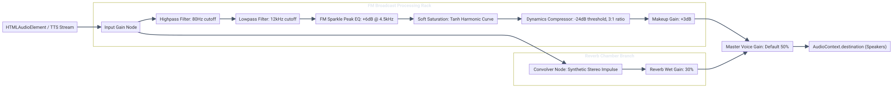

DJ speech is processed in real time using the browser's Web Audio API. Audio elements are routed through an effects rack designed to simulate commercial FM broadcast processing:

<details>
<summary>View Mermaid Source</summary>

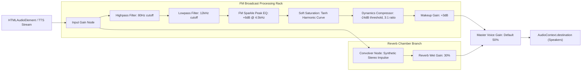

</details>

---

### Music and DJ Audio Mixing Flowchart (Diagram 4)

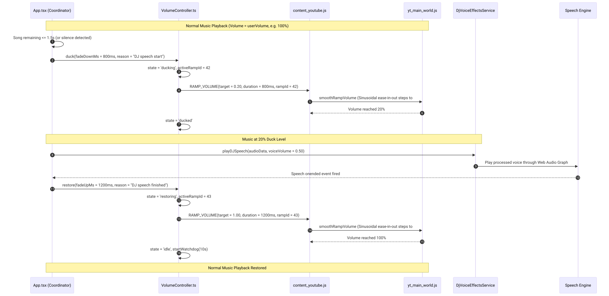

<details>
<summary>View Mermaid Source</summary>

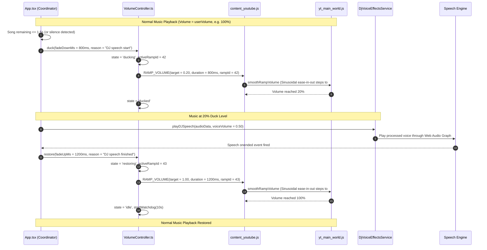

</details>

---

## 6. Chrome Extension and YouTube Integration

### Extension Architecture
The companion Chrome extension bridges the security boundaries between the RetroFM web app (`localhost:3003`), the YouTube video tab (`youtube.com`), and the standalone Boom Box player window (`chrome-extension://...`).

### Component Responsibilities & Message Routing

| Channel | Sender | Receiver | Protocol / Mechanism | Payload / Message Types |
| :--- | :--- | :--- | :--- | :--- |
| **App Bridge** | `src/App.tsx` | `content_retrofm.js` | `window.postMessage` (`RETRO_FM_PAGE`) | `PING`, `NAVIGATE_YOUTUBE`, `COMMAND_YOUTUBE`, `RAMP_VOLUME` |
| **Page Relay** | `content_retrofm.js` | `background.js` | `chrome.runtime.sendMessage` | Standardized JSON RPC with incremental message IDs |
| **Tab Command**| `background.js` | `content_youtube.js`| `chrome.tabs.sendMessage` | `PLAY`, `PAUSE`, `STOP`, `SEEK`, `SET_VOLUME`, `RAMP_VOLUME` |
| **World Bridge**| `content_youtube.js` | `yt_main_world.js` | `window.dispatchEvent` (CustomEvent) | `RETROFM_SET_YT_VOLUME`, `RETROFM_PLAYER_COMMAND`, `RETROFM_SET_YT_BALANCE` |
| **Status Push**| `yt_main_world.js` | `content_youtube.js`| CustomEvents & `postMessage` | `RETROFM_YT_STATE_CHANGED`, `RETROFM_VU_LEVELS_MSG` |
| **State Relay** | `content_youtube.js`| `background.js` | `chrome.runtime.sendMessage` | `YT_STATE_CHANGED`, `VU_AUDIO_LEVELS`, `RECORD_TRACE` |
| **Boom Box Bus**| `player.js` | `background.js` | `chrome.runtime.sendMessage` | `BOOMBOX_ACTION` (Tuning, Preset, Transport, Volume) |
| **State Push** | `background.js` | `player.js` | `chrome.tabs.sendMessage` | `APPLY_RADIO_STATE` (Current song, artist, year, frequency, dial) |

---

### Communication and Event Flow (Diagram 5)

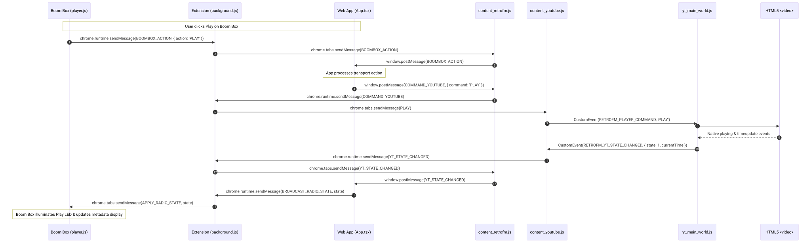

<details>
<summary>View Mermaid Source</summary>

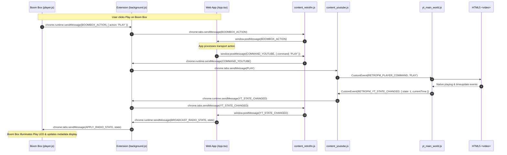

</details>

---

## 7. Music Library and Data Management

### Authoritative SQLite Database (`~/retrofm/library.sqlite`)
The primary data warehouse resides at `~/retrofm/library.sqlite`. It is queried at runtime via Node.js native `DatabaseSync` (`node:sqlite`) or `bun:sqlite`.

#### Core Database Schema
- **`songs`**: Master catalog of historical tracks.
  - Columns: `id`, `title`, `artist`, `primary_artist`, `chart_year`, `chart_year_rank`, `decade`, `release_date`, `release_date_precision`, `album`, `duration_sec`, `mbid`, `genres`, `primary_genre`, `peak_position`, `first_chart_date`, `last_chart_date`, `peak_date`, `weeks_on_chart`, `streaming` (JSON containing YouTube ID).
- **`weekly_chart`**: Weekly Billboard Hot 100 historical chart data.
  - Columns: `chart_date` (YYYY-MM-DD), `rank` (1–100), `title`, `performer`.
  - Indexed on `idx_wc_date` and `idx_wc_title` for sub-millisecond weekly lookups.
- **`song_facts`**: Verified historical music trivia and credits.
  - Columns: `song_id`, `fact_type` (`writer` | `producer`), `fact_text`, `event_date`, `public_date`, `source`, `source_url`, `times_used`.
- **`band_members`**: Era-accurate band rosters.
  - Columns: `band_name`, `member_name`, `begin_date`, `end_date`.
- **`artist_aliases`**: Alternative artist representations.
  - Columns: `artist_name`, `alias_name`, `alias_type`.
- **`genres`**: Permissible decade-by-decade musical taxonomy.
- **`bad_videos`**: Blacklist of broken, restricted, or low-quality YouTube video IDs.

### Static JSON Distribution (`/public/data/retrofm_library_youtube.json`)
To avoid runtime database locks and provide client-side independence, a sanitized snapshot of the songs table is exported to `/public/data/retrofm_library_youtube.json`. The web client loads this file directly into memory on initialization, ensuring zero SQL queries or backend dependencies during routine song selection.

---

## 8. End-to-End Broadcast Workflow

### Complete Cycle Overview
An authentic radio broadcast consists of a continuous feedback loop connecting station tuning, track playback, ahead-of-time DJ preparation, real-time audio ducking, and auto-advancement.

### End-to-End Broadcast Workflow (Diagram 6)

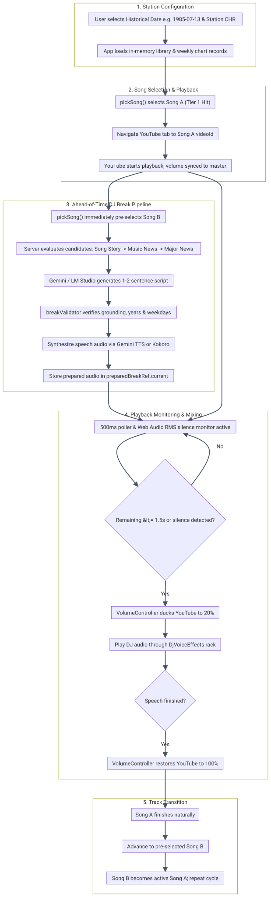

<details>
<summary>View Mermaid Source</summary>

```mermaid
flowchart TD
    subgraph StationInit["1. Station Configuration"]
        UserConfig[User selects Historical Date e.g. 1985-07-13 & Station CHR]
        LoadCatalog[App loads in-memory library & weekly chart records]
    end

    subgraph TrackSelection["2. Song Selection & Playback"]
        PickCurrent["pickSong() selects Song A (Tier 1 Hit)"]
        NavYT["Navigate YouTube tab to Song A videoId"]
        PlaySong["YouTube starts playback; volume synced to master"]
    end

    subgraph AheadPrep["3. Ahead-of-Time DJ Break Pipeline"]
        PickNext["pickSong() immediately pre-selects Song B"]
        ReqSegment["Server evaluates candidates: Song Story -> Music News -> Major News"]
        RunLLM["Gemini / LM Studio generates 1-2 sentence script"]
        ValidateBreak["breakValidator verifies grounding, years & weekdays"]
        GenTTS["Synthesize speech audio via Gemini TTS or Kokoro"]
        HoldAudio["Store prepared audio in preparedBreakRef.current"]
    end

    subgraph PlaybackMonitoring["4. Playback Monitoring & Mixing"]
        PollStatus["500ms poller & Web Audio RMS silence monitor active"]
        CheckTime{"Remaining <= 1.5s or silence detected?"}
        LeadDuck["VolumeController ducks YouTube to 20%"]
        TriggerSpeech["Play DJ audio through DjVoiceEffects rack"]
        SpeechEnd{"Speech finished?"}
        RestoreVol["VolumeController restores YouTube to 100%"]
    end

    subgraph TrackTransition["5. Track Transition"]
        SongFinished["Song A finishes naturally"]
        AutoAdvance["Advance to pre-selected Song B"]
        LoopBack["Song B becomes active Song A; repeat cycle"]
    end

    UserConfig --> LoadCatalog
    LoadCatalog --> PickCurrent
    PickCurrent --> NavYT
    NavYT --> PlaySong
    PlaySong --> PickNext
    PickNext --> ReqSegment
    ReqSegment --> RunLLM
    RunLLM --> ValidateBreak
    ValidateBreak --> GenTTS
    GenTTS --> HoldAudio
    HoldAudio --> PollStatus
    PlaySong --> PollStatus
    PollStatus --> CheckTime
    CheckTime -- No --> PollStatus
    CheckTime -- Yes --> LeadDuck
    LeadDuck --> TriggerSpeech
    TriggerSpeech --> SpeechEnd
    SpeechEnd -- Yes --> RestoreVol
    RestoreVol --> SongFinished
    SongFinished --> AutoAdvance
    AutoAdvance --> LoopBack
```

</details>

---

## 9. Key Files and Responsibilities

The following repository-relative source files implement RetroFM:

| File Path | Primary Class / Functions | Core Responsibility |
| :--- | :--- | :--- |
| `server.ts` | `startServer`, Express API routes | Hosts API endpoints, serves Vite SPA, interfaces with SQLite, LLMs, and TTS. |
| `src/App.tsx` | `App`, `playLibrarySongInternal`, `handlePlayDjSpeech` | Central application state coordinator, playback loop, DJ timing triggers, diagnostics. |
| `src/services/songSelector.ts` | `pickSong`, `existedBy`, `isStrictlyReleasedBefore` | Deterministic song selection, 4-tier filtering, release date validation, hit weighting. |
| `src/services/music/YouTubeMusicProvider.ts` | `YouTubeMusicProvider` | Client bridge communicating with companion extension via `window.postMessage`. |
| `src/services/music/songSearch.ts` | `searchYouTubeForSong`, `getVideoDuration` | Fallback YouTube Search API client and duration cache. |
| `src/services/music/songStoryCardService.ts` | `getOrBuildSongStoryCard` | Compiles song facts, band members, and Wikipedia story cards for upcoming tracks. |
| `src/services/news/factPacketService.ts` | `buildFactPacket`, `getNewsSessionStats` | Retrieves, filters, and packages historical news articles from NYT Archive API. |
| `src/services/news/almanacService.ts` | `getOrBuildAlmanac`, `resolveRelativeTimeWords` | Builds historical daily almanacs, relative time resolution, news categories. |
| `src/services/djBreak/breakDecisionEngine.ts` | `decideAndSelectBreak`, `SongCreditRepository` | Evaluates eligible candidates, checks session history, prevents repeating fact types. |
| `src/services/djBreak/chartFacts.ts` | `ChartFactRepository`, `computeChartFacts` | Queries `weekly_chart` in SQLite for song ranking trajectory and #1 hits. |
| `src/services/djBreak/breakValidator.ts` | `validateSegmentBreakOutput`, `validateBreakOutput`| Deterministic verification of script length, grounding, historical years, and banned words. |
| `src/services/djBreak/GeminiScriptWriterProvider.ts`| `GeminiScriptWriterProvider` | Generates DJ commentary scripts and performs audits using Google Gemini models. |
| `src/services/djBreak/LMStudioScriptWriterProvider.ts`| `LMStudioScriptWriterProvider` | Local LLM fallback provider connecting to OpenAI-compatible LM Studio endpoints. |
| `src/services/tts/GeminiTTSProvider.ts` | `GeminiTTSProvider` | Synthesizes neural audio speech using Gemini Flash audio preview models. |
| `src/services/tts/KokoroTTSProvider.ts` | `KokoroTTSProvider` | Local neural TTS provider interfacing with local Kokoro-82M container/daemon. |
| `src/services/ttsClient.ts` | `generateTTS`, `fetchKokoroStatus` | Client-side HTTP wrapper requesting audio generation from `/api/tts/generate`. |
| `src/services/audio/VolumeController.ts` | `VolumeController` | Single authority managing volume ducking, restoring, watchdog monitoring, and ramp IDs. |
| `src/services/audio/DjVoiceEffectsService.ts` | `DjVoiceEffectsService` | Real-time Web Audio API rack for FM broadcast compression, EQ, saturation, and reverb. |
| `extension/background.js` | `handleIncomingRequest`, `resolveRetroFmTab` | MV3 background service worker routing IPC between extension tabs and content scripts. |
| `extension/content_retrofm.js` | `onWindowMessage`, `announceReady` | Bridges web app `window.postMessage` events to `chrome.runtime.sendMessage`. |
| `extension/content_youtube.js` | `smoothRampVolume`, `getPlaybackStatus` | Controls YouTube `<video>` DOM, listens for commands, dispatches main-world events. |
| `extension/player/yt_main_world.js` | `ensureStereoBalanceNodes`, `applyVolumeToPlayer` | Injected into YouTube MAIN page world; controls `#movie_player`, balance, and VU meter. |
| `extension/player/player.js` | `act`, `applyRadioState`, `setVisualTransport` | Standalone Boom Box radio interface, station presets, frequency dial, volume knob. |

---

## 10. External Services and Dependencies

### AI Text Generation
- **Google Gemini API**:
  - Primary model: `gemini-3.8-flash` (configurable via `GEMINI_TEXT_MODEL`).
  - Fallback model: `gemini-2.5-flash` (configurable via `GEMINI_TEXT_MODEL_FALLBACK`).
  - Operational role: DJ break script writing and historical anachronism audits.
- **LM Studio (Local LLM)**:
  - Connects to local OpenAI-compatible endpoint (default `http://localhost:1234/v1`).
  - Operational role: High-speed, offline script writing alternative.

### Text-to-Speech (TTS)
- **Google Gemini Flash TTS**:
  - Primary model: `gemini-2.5-flash-preview-tts` (fallback: `gemini-3.8-flash-lite-tts`).
  - Voice profiles: `Puck` (energetic male radio host), `Aoede` (expressive female radio host).
- **Kokoro-82M TTS**:
  - Connects to local Kokoro HTTP daemon (default `http://127.0.0.1:8880`).
  - Voices: `am_michael` (American Male DJ), `bm_george` (British BBC host), `af_bella` (American Female).
- **Instant Browser Speech**:
  - Native Web Speech API (`window.speechSynthesis`). Zero network latency; runs locally in Google Chrome.

### Upstream APIs
- **New York Times Archive API**: Historical news retrieval by publication year and month.
- **YouTube Data API v3**: Track search and video duration metadata verification.

---

## 11. Troubleshooting and Known Fallbacks

### Critical Service Fallbacks

| Failure Event | Detection Mechanism | System Fallback Behavior |
| :--- | :--- | :--- |
| **Gemini API 429 Quota Exceeded** | HTTP 429 / `RESOURCE_EXHAUSTED` | Automatically switches TTS engine to `BROWSER` (Web Speech API) with zero downtime. |
| **LLM Script Writing Timeout** | 25s candidate queue budget | Aborts candidate generation and delivers a clean `plain_intro` handoff or silence. |
| **TTS Synthesis Failure** | Server HTTP 500 / empty buffer | Break is discarded; station remains silent and plays music directly without stalling. |
| **Break Audio Not Ready at Song End** | `prep.audioData == null` at trigger | Station logs `[DJ skipped: audio not ready]`, cancels lead duck, and plays next track. |
| **YouTube Autoplay Blocked** | `video.play()` rejection | Extension alerts user; app offers one-time click prompt to satisfy Chrome user-gesture policy. |
| **Background Tab Throttling** | `document.visibilityState == 'hidden'` | `DjVoiceEffectsService` runs a silent keep-alive loop to prevent Chrome from suspending AudioContext. |
| **Extension Context Invalidation** | `chrome.runtime.lastError` | Page bridge content script re-injects on extension update; prompts user to reload tabs. |
| **Ducking Lockup / Hang** | 45-second watchdog timer in `VolumeController` | Automatically cancels active duck sequence and restores music volume to `userVolume`. |
